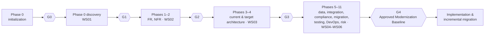

# Methodology

The kit turns [the brief](brief.md) into a workflow that people and agents can follow and a tool can check. This page
is the map: which workstream does what, in which order, producing which deliverable, approved at which gate.

## Roles

| Role | Owns | Charter |
| --- | --- | --- |
| **PA** Principal Architect | Governance, decisions, integration across workstreams, the single baseline | [principal-architect](../workspace/.claude/agents/principal-architect.md) |
| **WS01** Legacy Discovery | Source analysis, dependencies, business-rule extraction | [ws01-legacy-discovery](../workspace/.claude/agents/ws01-legacy-discovery.md) |
| **WS02** Requirements | FR, NFR, compliance inputs, acceptance criteria | [ws02-requirements](../workspace/.claude/agents/ws02-requirements.md) |
| **WS03** Architecture | Current state, target state, stack evaluation, ADRs | [ws03-architecture](../workspace/.claude/agents/ws03-architecture.md) |
| **WS04** Data & Integration | Database, data migration, APIs, external dependencies | [ws04-data-integration](../workspace/.claude/agents/ws04-data-integration.md) |
| **WS05** Migration Planning | Strategy, work packages, sequencing, estimates, roadmap, cutover | [ws05-migration-planning](../workspace/.claude/agents/ws05-migration-planning.md) |
| **WS06** Quality & Security | Testing strategy, security, compliance, quality gates | [ws06-quality-security](../workspace/.claude/agents/ws06-quality-security.md) |

The charters are the workspace's agent definitions; a human team member in a role follows the same text. Workstreams
never publish a separate version of the truth: the PA consolidates their output, records contradictions as `CF-` rows
in `baseline-conflicts.md`, and keeps one baseline.

## From brief to gates

| Brief phase | Workstream | Deliverables | Gate |
| --- | --- | --- | --- |
| 0 Initialization: target stack, context | PA | D01, DEC-001 or Q-001 | G0 |
| 0 Repository and system discovery | WS01 | D02 and the discovery report | G1 |
| 1 Functional requirements, business rules | WS02 with WS01 | D03 (FR-, BR-, WF-) | G2 |
| 2 Non-functional requirements | WS02 with WS06 | D04 (NFR-) | G2 |
| 3 Current-state architecture | WS03 with WS01 | D05, D06 (TD-) | G3 |
| 4 Target architecture, stack evaluation | WS03 | D07, D08, D09 (ADR-) | G3 |
| 5 Data and database | WS04 | D10 (DM-) | G4 |
| 6 Integration | WS04 | D11 (INT-) | G4 |
| 7 Compliance and governance | WS06 | D12 (CMP-) | G4 |
| 8 Migration strategy and work breakdown | WS05 | D13 (WP-), D17 (MS-), D18 | G4 |
| 9 Quality engineering and testing | WS06 | D14 (TC-, QG-), D20 | G4 |
| 10 DevOps and release | WS05 with WS06 | D15, D19 | G4 |
| 11 Risk | PA with all | D16 (RISK-) | G4 |

Gates are sequential: a gate opens only when the previous one has a current approval. Work on a later phase may start
earlier — WS04 can study the schema during discovery — but its deliverables are judged at their own gate.

## How a gate is reached

1. The owning workstream drafts its deliverables, labelling every finding (see [fact labels](../spec/README.md#fact-labels))
   and linking evidence into `legacy/`.
2. It sets the deliverable's front-matter `status` to `in-review` when it considers the work complete.
3. The PA runs a consolidation pass: cross-checks the workstreams, records contradictions as `CF-` rows, and resolves
   or escalates them.
4. `dmz trace` (or `--strict` for G4) reports zero errors.
5. A person reviews and approves the gate in the studio or with `dmz approve`.

## When information is missing

Follow the brief's rule: identify exactly what is unknown, say why it matters, check whether discovery can resolve it,
and ask a person only when a decision or external information is genuinely needed. In the workspace that means a `Q-`
row with an owner, or an `ASM-` row that says how the assumption will be validated. Nothing is invented silently.

## Target stacks

The workspace starts stack-neutral. When the target is chosen — at G0, or by G3 at the latest — the matching pack under
[`targets/`](../targets) is applied: the D08 evaluation scaffold, seed ADRs in *Proposed* status, the Delphi semantic
differences to verify, the coding standards and the quality baseline for implementation.
